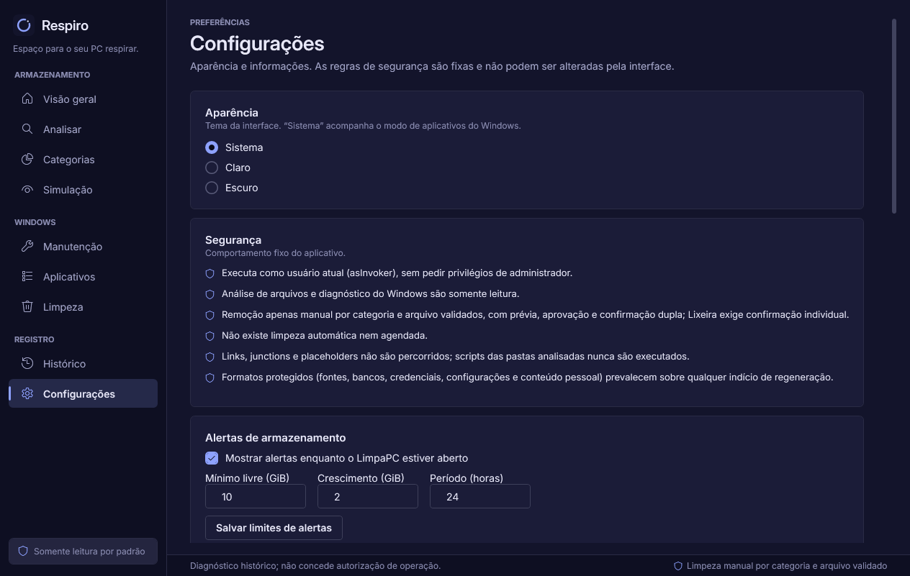
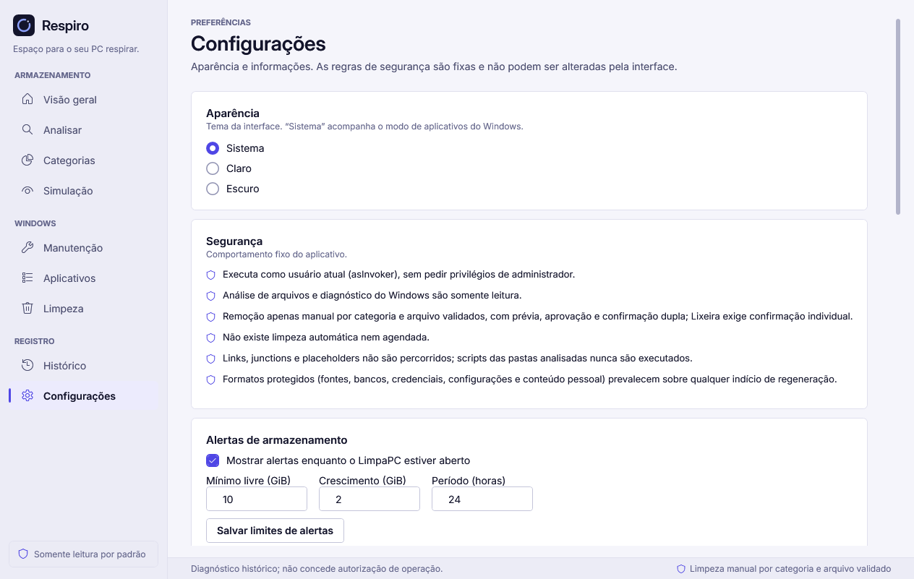

# Respiro

**Espaço para o seu PC respirar.**

Aplicativo desktop em português para entender o armazenamento do Windows, encontrar arquivos grandes e revisar oportunidades de limpeza com segurança. Desenvolvido para pessoas que desejam cuidar do computador sem precisar conhecer ferramentas de programação.

> **Estado: código-fonte Beta em preparação.** As operações avançadas de Otimização ainda não foram homologadas em VM descartável. Alteração de inicialização, fechamento de aplicativos e desinstalação MSI permanecem bloqueados na candidata atual. Publicar os fontes não libera essas operações. Este repositório não oferece executáveis nem instaladores nesta etapa.

## O que já funciona

- Análise progressiva de discos e pastas, com cancelamento, árvore de arquivos, categorias, extensões e gráficos.
- Exploração dos maiores arquivos, vídeos, Downloads, instaladores, compactados e arquivos sem modificação recente; localização no Explorador.
- Possíveis duplicatas por metadados e comparação opcional por conteúdo SHA-256, progressiva e cancelável. Nenhuma cópia é excluída automaticamente.
- Limpeza rápida e limpeza manual restrita, com explicações, seleção, simulação, confirmação e revalidação dos itens elegíveis.
- Inventário de aplicativos com busca, ordenação, fabricante, versão e tamanho quando conhecido.
- Diagnósticos e orientações de manutenção do Windows, com encaminhamento nativo quando necessário.
- Histórico, comparação de análises, crescimento de pastas e alertas de espaço livre.
- Inventários de inicialização e processos em modo diagnóstico.
- Recursos avançados para desenvolvimento, caches comprovados e Docker/WSL, com proteção de dados e ambientes.
- Temas claro e escuro, fonte Inter e navegação por teclado.

Espaço ocupado, estimativa de recuperação e recuperação comprovada são valores diferentes. Abrir as Configurações do Windows não significa que o Respiro executou uma limpeza.

## Limpeza e segurança

O Respiro não trata toda a pasta Temp como descartável. Os adaptadores verificam origem, formato, integridade, uso e proteções. Categorias não comprovadas permanecem bloqueadas ou são encaminhadas ao mecanismo oficial do Windows.

A remoção direta é limitada a casos específicos: cópias temporárias comprovadas do próprio aplicativo, minidumps estruturais elegíveis, caches de miniaturas reconhecidos, itens individuais da Lixeira com origem temporária comprovada e cache npm público validado. Estar nessas categorias não garante elegibilidade de um arquivo.

Não há limpeza automática, desinstalação em lote, limpador genérico de Registro ou elevação administrativa automática. Arquivos pessoais, fontes, bancos, credenciais, worktrees, dados de agentes, Docker/WSL e evidências protegidas não são considerados descartáveis. A compatibilidade com os marcadores legados `.limpapc-protect` e `LimpaPC.TEMP/1` permanece.

**Uma remoção aprovada pode ser permanente.** Leia a prévia e as consequências; não conte com a Lixeira ou recuperação posterior. Veja [segurança e limitações](docs/public/SEGURANCA-E-LIMITACOES.md).

## Capturas da interface

Capturas existentes de uma versão anterior, revisadas sem caminhos pessoais, nomes de arquivos ou inventários privados. Ilustram os temas; textos e navegação podem diferir da candidata atual.

| Tema escuro | Tema claro |
|---|---|
|  |  |

## Stack e requisitos

- C# e .NET 10, interface WPF, APIs do Windows.
- Windows 11 x64 como alvo inicial. Windows 10 ainda não homologado; compatibilidade depende também da edição/build suportados pelo .NET.
- Para desenvolver: SDK .NET **10.0.402**, conforme global.json, PowerShell e Git. Não há dependências NuGet externas.
- Para executar um build: .NET **Desktop Runtime 10 x64**; o SDK não é requisito de execução.
- Pelo menos **12 GiB livres no C:** antes de cada etapa de build, mantendo a reserva mínima de 10 GiB. Prefira 20 GiB para validação completa.

Os runtimes e SDKs não estão incluídos. Consulte os [downloads oficiais do .NET 10](https://dotnet.microsoft.com/download/dotnet/10.0) e a [compatibilidade oficial com Windows](https://learn.microsoft.com/dotnet/core/install/windows).

## Compilar e executar

No Windows, com o SDK indicado instalado:

```powershell
git clone https://github.com/viniohc/respiro.git
cd respiro
powershell -NoProfile -File .\build.ps1
.\src\Respiro.App\bin\Release\net10.0-windows\Respiro.App.exe
```

O script usa primeiro um SDK local em .sdk, se existente, ou o dotnet instalado no PATH. Também aceita -DotNetPath com o caminho de um dotnet.exe já instalado. Não baixa nem instala dependências. Mantém a guarda de armazenamento, compila o aplicativo e executa a suíte local antes de concluir.

Não é necessário executar como administrador. A aplicação cria preferências e registros locais quando utilizada; relatórios exportados podem conter caminhos pessoais e não devem ser compartilhados sem revisão.

## Testes e estado da Beta

A validação local mais recente registrou **298/298 testes aprovados**. Há **16 cenários operacionais preparados, ainda pendentes de VM autorizada**. O resultado anterior de 308/308 é histórico e não comprova o ciclo operacional em instalação limpa.

O build padrão não executa os cenários nativos de Run, processos descartáveis e MSI. O identificador privado da máquina de preparação e os manifestos/evidências operacionais não são versionados. Sem a atestação privada, o runner operacional recusa a execução; isso não impede a suíte local.

Também permanecem pendentes, no convidado Windows, a execução sem SDK, a instalação/remoção da fixture MSI, permissões, cancelamento, temas, DPI e acessibilidade. Veja [estado de validação e desenvolvimento](docs/public/DESENVOLVIMENTO.md). Nenhum teste unitário desbloqueia as operações da Beta.

## Estrutura

- src/Respiro.App — interface WPF, navegação e integração dos fluxos.
- src/Respiro.Core — análise, classificação, proteções e serviços.
- tests/Respiro.Tests — testes locais e cenários operacionais separados.
- tests/Respiro.OperationalHost — processo descartável de teste; não faz parte do aplicativo.
- docs/public — documentação e capturas revisadas para publicação.

Builds, SDKs, caches, backups, logs, relatórios privados e dados pessoais permanecem fora do Git.

## Licença

Código próprio sob [MIT](LICENSE). As fontes Inter permanecem sob [SIL OFL 1.1](src/Respiro.App/Fonts/Inter-LICENSE.txt); consulte os [avisos de terceiros](THIRD-PARTY-NOTICES.md).
